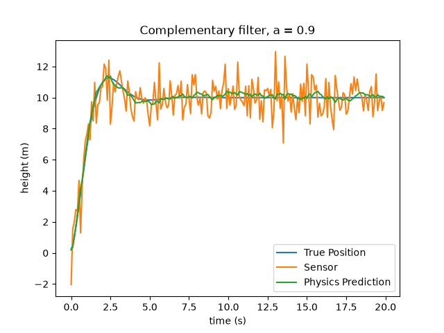

# complementary-filter

A 1-D simulation of a drone holding altitude at 10 m, estimating its height by
blending a physics prediction with a noisy sensor.

## the filter

The filter consists of this line:

    estimate = a * prediction + (1 - a) * measurement

This program predicts a drone's height using physics. Then a 
a velocity error is added (a small error that an accelerometer could  have)
and make the prediction that way. The problem is that this error builds
up over time, so the prediction drifts away from the truth. To correct it
I added a sensor, but the sensor is not accurate either, and every reading
has its own error. `a` sets what percentage of the estimate comes from physics
and what percentage from the sensor.

## parameters

| name | value | meaning |
|---|---|---|
| dt | 0.1 | time step, seconds |
| steps | 200 | number of steps (so 20 s total) |
| target | 10.0 | height the drone holds, metres |
| Kp | 2.0 | proportional gain |
| Kd | 1.5 | derivative gain |
| velocity_bias | 0.1 | accelerometer error, m/s |
| a | 0.9 | percentage of the estimate taken from physics |

## results

| a | smoothness | leftover drift |
|---|---|---|
| 0.5 | jumpy, half the sensor noise | none |
| 0.9 | smooth | none |
| 0.98 | smoother than 0.9 | sits above the truth |
| 0.999 | smoothest | ~1.6 m at the end |

For the final graph I used 90% of the physics prediction and 10% of the sensor
data, so when the physics prediction is wrong the sensor corrects it as the
simulation runs.

This is a complementary filter. It is a Kalman filter where the blend is
chosen by hand instead of calculated every step.